<div align="center">


<a href="https://linkedin.com/in/omar-m-1866b3297"></a>
<a href="https://www.researchgate.net/publication/404383970_Enhancing_Public_Wi-Fi_Hotspot_Security_An_Experimental_Evaluation_of_WPA3-SAE_with_Multi-Layered_Authentication_Policies"></a>
<a href="mailto:om2618686@gmail.com"></a>

</div>

<br/>

```js
// ~/.profile.js

const maroo = {
  name:        "Omar Mahmoud Bayuomy",
  aka:         ["Maroo", "3AMURR"],
  studying:    "Computers & Information Systems @ Egyptian Chinese University  // 2024 → 2028",

  published:   "WPA3-SAE & public Wi-Fi security — Int'l Journal of Telecommunications, 2026",
  leading:     ["Founder & President @ ICPC ECU-CS", "Co-Lead @ GDG on Campus ECU", "Organizer @ TEDxECU"],
  building:    "UnoSyn — a tech-services startup",
  graduated:   ["DEPI R4 · Data Analyst Specialist", "InnovEgypt (ITIDA) · Entrepreneurship"],
  previously:  ["Intern @ CIB Egypt", "HR @ Devs Community", "Head of Operations @ GDG ECU"],

  interests:   ["data", "cybersecurity", "competitive programming", "IoT & robotics"],
  lookingFor:  ["Data Analyst", "Data Engineer", "Data Scientist"],
  activeHours: "03:00 AM, obviously",
};
```

<br/>

<a href="https://www.researchgate.net/publication/404383970_Enhancing_Public_Wi-Fi_Hotspot_Security_An_Experimental_Evaluation_of_WPA3-SAE_with_Multi-Layered_Authentication_Policies">
  
</a>

<br/><br/>


<br/><br/>

<p><code>$ ls ~/projects</code></p>

<table>
<tr><td width="50%">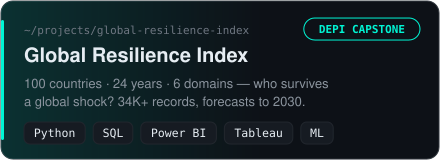</td><td width="50%">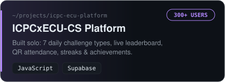</td></tr>
<tr><td width="50%">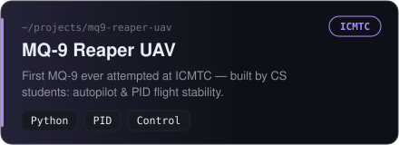</td><td width="50%">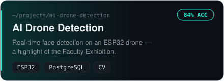</td></tr>
<tr><td width="50%">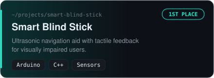</td><td width="50%">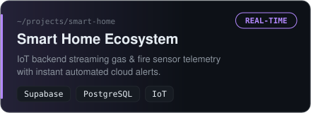</td></tr>
<tr><td width="50%">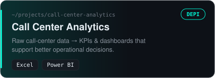</td><td width="50%">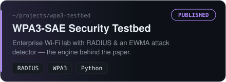</td></tr>
</table>

<br/>


<br/>

```yaml
# ~/stack.yml
languages: [Python, SQL, C++, JavaScript, Dart]
data:      [Pandas, Power BI, Tableau, Excel, Power Query, Streamlit, forecasting]
backend:   [Supabase, PostgreSQL, MySQL]
hardware:  [Arduino, ESP32, Raspberry Pi]
security:  [WPA3 / Wi-Fi security, RADIUS, Networking (CCNA)]
```

<div align="center">
  
  <br/><br/>
  
  
  <br/><br/>
  <picture>
    <source media="(prefers-color-scheme: dark)" srcset="https://raw.githubusercontent.com/3AMURR/3AMURR/output/github-snake-dark.svg" />
    <source media="(prefers-color-scheme: light)" srcset="https://raw.githubusercontent.com/3AMURR/3AMURR/output/github-snake.svg" />
    
  </picture>
</div>

```bash
$ exit
logout — see you at 3AM 🌙
```
